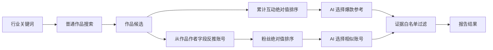
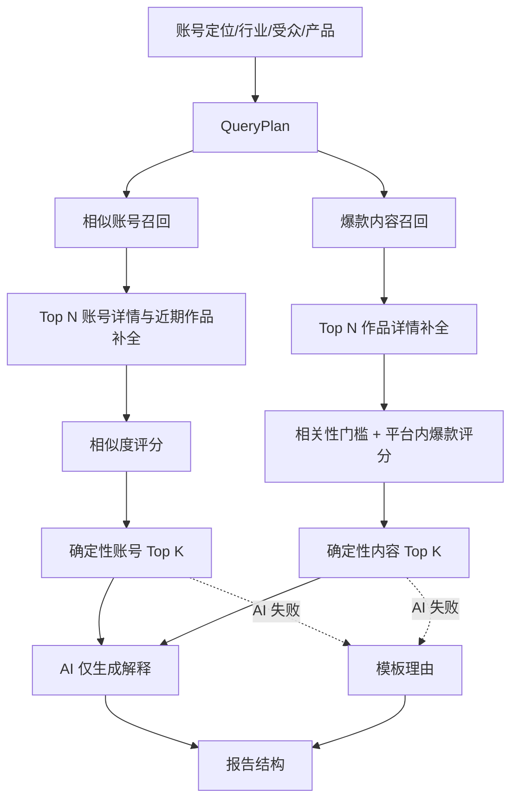

# 基于 TikHub 新能力的相似账号与爆款参考生成优化设计

> 日期：2026-07-21  
> 状态：待评审  
> 适用范围：账号报告中的 `similarAccounts` 与 `hotContents`  
> 前置设计：[StarX 社媒检索统一切换 TikHub 可实现方案](../../../../docs/superpowers/specs/2026-07-21-tikhub-social-retrieval-migration-design.md)

## 1. 结论

当前“相似账号”和“爆款笔记参考”生成失败，不是单纯的提示词或模型稳定性问题，而是采集、证据构建和生成边界共同造成的结构性问题：

1. 小红书作品详情仍调用已下线的 App V1 `get_note_info_v2`。TikHub 于 2026-06-17 永久下线小红书 App V1、Web V2 和 Web V3，并要求迁移到 App V2；因此包含作品详情补全的链路会直接失败。
2. 相似账号目前没有独立的“账号召回”过程，只从普通笔记搜索结果中的作者字段反推账号。作者缺少粉丝数、作品数和主页内容等核心特征，最终往往被填成 0，无法判断相似度。
3. 爆款参考只执行普通关键词搜索，再按历史累计互动绝对值排序；没有使用 TikHub 新增或已有的多排序搜索、创作灵感、抖音热榜和低粉爆款能力，也没有处理发布时间、账号体量和跨平台指标口径。
4. `similarAccounts` 和 `hotContents` 的最终身份选择交给大模型，但工作流随后又用严格证据白名单过滤。模型一旦输出缺失 ID、平台别名不一致或格式错误，结果会被过滤为空。`hotContents` 有部分确定性补位，`similarAccounts` 没有同等级降级。

本次优化应将两部分改造为两条独立、确定性优先的发现管线：

- 相似账号：多源账号召回 → 账号详情和近期作品补全 → 相似度评分 → 确定性 Top K → AI 只生成推荐理由。
- 爆款参考：多排序搜索与平台热榜召回 → 详情补全 → 相关性门槛 → 平台内热度归一化与破圈评分 → 类型/平台配额 → AI 只生成参考理由。

无论 AI 是否成功，两部分都必须能从可信证据生成完整结构；单个 TikHub 能力失败时只降级对应来源，不得使整份账号报告失败。

## 2. TikHub 公告与能力基线

### 2.1 必须立即遵守的接口代际约束

TikHub 小红书迁移公告明确说明，自 2026-06-17 起 App V1、Web V2、Web V3 永久下线，统一使用 App V2。当前实现中的以下调用必须移除：

```python
client.call("xiaohongshu_app", "get_note_info_v2", ...)
```

替换原则：

- 图文笔记调用 App V2 `get_image_note_detail`。
- 视频笔记调用 App V2 `get_video_note_detail`。
- 搜索接口已经返回内容类型时，沿用该类型选择详情接口。
- 仅有链接且类型未知时，先通过 App V2 搜索/账号笔记元数据或统一身份解析确认类型；不得以“图文接口失败后再试视频接口”作为常规双计费探测。
- 任何情况下不得回退至已下线的 App V1 或 Web V2/V3。

### 2.2 本设计使用的 TikHub 能力

| 场景 | 平台 | TikHub 能力 | 使用方式 |
| --- | --- | --- | --- |
| 账号关键词召回 | 小红书 | App V2 `search_users` | 相似账号主召回 |
| 账号内容补全 | 小红书 | App V2 `get_user_info`、`get_user_posted_notes` | 补粉丝、作品和内容主题 |
| 多维笔记搜索 | 小红书 | App V2 `search_notes` | 按热度、收藏、评论、时间和笔记类型召回 |
| 热门灵感 | 小红书 | App V2 `get_creator_hot_inspiration_feed` | 召回趋势内容，业务侧再做行业相关性过滤 |
| 创作灵感 | 小红书 | App V2 `get_creator_inspiration_feed` | 补充按创作分类的趋势候选 |
| 商业博主筛选 | 小红书 | 蒲公英 `get_blogger_list` 等 | 可选高成本增强，仅在配置品牌 `brand_user_id` 时启用 |
| 账号关键词召回 | 抖音 | Search `fetch_user_search_v2` | 免费/标准主召回 |
| 相似达人 | 抖音 | Index `fetch_daren_similar_users` | 已知当前账号数值 UID 时作为高置信召回 |
| 优质达人建议 | 抖音 | Index `fetch_daren_sug_great_user_list` | 行业关键词扩展召回 |
| 达人高级筛选 | 抖音 | Xingtu `search_kol_v2` | 可选高成本增强，支持粉丝区间与内容标签 |
| 行业爆款 | 抖音 | Search `fetch_video_search_v2` | 关键词、时间、排序的主召回 |
| 爆款榜单 | 抖音 | Billboard `fetch_hot_total_video_list` | 优先使用低粉爆款、高点赞率等子榜单 |
| 热门账号 | 抖音 | Billboard `fetch_hot_account_list` | 只做补充召回，不直接等同于“相似” |
| 账号/作品搜索 | 快手 | App `search_user_v2`、`search_video_v2` | 标准召回后补详情和近期作品 |

TikHub 当前 OpenAPI 为 V5.3.2，但仓库锁定的 `tikhub==2.1.2` 尚未暴露小红书蒲公英资源，部分热榜方法的 SDK 签名也可能落后于 OpenAPI。蒲公英、热榜新参数接入前必须先升级 SDK 或实现有类型约束的 HTTP adapter，并通过契约测试；业务层不得直接使用动态 `/tikhub/call` 绕过验证。

## 3. 当前失败机制

### 3.1 当前数据流



### 3.2 代码级根因

| 问题 | 当前表现 | 后果 |
| --- | --- | --- |
| 小红书详情使用 App V1 | `provider.py` 调用 `xiaohongshu_app.get_note_info_v2` | 公告生效后详情请求失败 |
| 小红书搜索 `source` 不符合新文档默认值 | 当前固定为 `web_search_result_notes`，新文档使用 `explore_feed` | 返回稳定性和翻页上下文存在风险 |
| 翻页状态只读第一层 | `page_state()` 不完整解析嵌套 `data.data`、`search_session_id` 等 | 容易只取第一页或丢失检索会话 |
| 相似账号来自作品作者 | `crawl_by_keyword()` 只调用作品搜索 | 粉丝、作品、互动和主页标签缺失 |
| 相似度等于账号规模 | `_creator_rank=(fans, interaction, hit_count)` | 大号被误判为相似号，小而精准的账号被淘汰 |
| 爆款等于历史累计互动 | `like + collect*2 + comment*3 + share*4` | 老内容、大号内容天然占优，无法识别近期破圈内容 |
| 跨平台直接比较绝对数 | 抖音播放/点赞与小红书收藏/点赞同榜排序 | 指标口径失真 |
| AI 决定候选身份 | 模型输出后再做 allowlist 过滤 | ID 或平台格式稍有偏差即为空 |
| 降级不对称 | 爆款有补位，相似账号没有 | 模型失败时相似账号必然空 |
| SDK 返回 `Any` | 通用递归解析找不到路径时返回空数组 | 上游结构变化被误判为“没有结果”，缺少告警 |

## 4. 目标架构

建议在账号报告内新建独立的参考发现领域模块，不再把两部分建立在通用 `CrawlResult` 排序之上：

```text
starx-backend/app/services/account_report/reference_discovery/
├── service.py                    # 两条发现管线的统一编排
├── models.py                     # 候选、评分、来源和执行状态
├── query_plan.py                 # 从账号定位生成可审计查询计划
├── similar_accounts.py           # 相似账号召回、补全、排序与选择
├── hot_contents.py               # 爆款召回、补全、排序与配额
├── scoring.py                    # 平台内归一化和评分函数
├── fallback.py                   # 无 AI 的确定性结果和理由模板
├── budget.py                     # 请求数、付费能力和补全预算
└── platforms/
    ├── douyin.py
    ├── xiaohongshu.py
    └── kuaishou.py
```



核心约束：

- TikHub 决定“有哪些公开候选”，评分器决定“选择谁”，AI 只解释“为什么值得参考”。
- 身份、指标、链接、发布时间、内容类型全部来自可信采集证据，AI 无权改写。
- 候选为空必须区分“确实无合格数据”与“接口/解析失败”，不得都返回空数组。
- 相似账号、爆款参考失败相互隔离，也不阻断账号报告的其他章节。

## 5. 相似账号生成逻辑

### 5.1 查询计划

从账号已有资料生成 2～4 个账号检索意图，而不是复用所有内容关键词。每个查询必须保存来源和目的：

1. 垂直赛道：如“露营装备博主”。
2. 内容角色：如“露营测评”“户外教程”。
3. 目标人群/使用场景：如“亲子露营”“城市周末户外”。
4. 产品或差异化标签：如“轻量化帐篷”“新手装备清单”。

查询由现有账号定位字段确定性拼装，AI 仅可做同义词扩展；若 AI 失败，仍能执行基础查询。禁止把宽泛词“生活”“好物”“日常”单独作为检索词。

### 5.2 平台召回策略

#### 小红书

1. App V2 `search_users` 执行账号意图查询，每个意图最多取 2 页。
2. 对去重后的初筛 Top 15 调用 `get_user_info` 补齐粉丝、作品数、简介和主页链接。
3. 对 Top 10 调用 `get_user_posted_notes`，取最近 3～5 篇公开笔记用于计算内容主题重合、活跃度和互动质量。
4. 若配置 `TIKHUB_XHS_PGY_ENABLED=true` 且存在品牌 `brand_user_id`，可用蒲公英 `get_blogger_list` 按粉丝区间做商业候选补充；蒲公英结果不得替代 App V2 标准召回。

#### 抖音

1. 若当前账号已解析出数值 UID，优先调用 Index `fetch_daren_similar_users`，作为高置信种子。
2. 对账号意图调用 Search `fetch_user_search_v2`，作为标准主召回。
3. 可用 Index `fetch_daren_sug_great_user_list` 补充“行业优质达人”。热门达人不等于相似达人，仍需统一评分。
4. 星图 `search_kol_v2` 仅在付费增强开关开启时调用，并根据当前账号粉丝量设置相邻粉丝区间、根据行业设置内容标签。
5. 对 Top 15 补账号详情，对 Top 10 取最近 3～5 个作品。

#### 快手

1. 使用 `search_user_v2` 执行账号意图查询。
2. 对 Top 15 补账号详情，对 Top 10 取最近 3～5 个作品。
3. 当前没有经过验证的原生相似达人接口，因此不虚构等价能力；依赖关键词召回与统一相似度模型。

### 5.3 候选数据模型

```python
class SimilarAccountCandidate(BaseModel):
    platform: Literal["dy", "xhs", "ks"]
    creator_hash: str
    native_user_id: str
    display_name: str
    profile_url: str
    description: str = ""
    followers: int = 0
    content_count: int = 0
    recent_contents: list[ContentDigest] = []
    matched_queries: list[str] = []
    source_operations: list[str] = []
    semantic_fit: float = 0
    content_overlap: float = 0
    scale_proximity: float = 0
    activity_score: float = 0
    engagement_quality: float = 0
    evidence_completeness: float = 0
    similarity_score: float = 0
    observed_at: datetime
```

必须保留 `source_operations` 和 `matched_queries`，以便定位“为什么召回这个账号”和 TikHub 哪个能力异常。

### 5.4 过滤与评分

先执行硬过滤：

- 排除当前账号的所有已知 ID、主页 URL 和稳定哈希。
- 排除缺少稳定账号 ID 或主页链接的候选。
- 排除昵称相同但身份无法确认的重复项。
- 排除无简介且无可用近期作品的空壳账号。
- 同平台按 native ID 去重，跨查询合并来源。

建议相似度：

```text
similarity_score =
    0.30 × semantic_fit
  + 0.25 × content_overlap
  + 0.15 × scale_proximity
  + 0.10 × activity_score
  + 0.10 × engagement_quality
  + 0.10 × evidence_completeness
```

各子分含义：

- `semantic_fit`：简介、标签、命中查询与目标行业/人群/场景的语义或关键词匹配。
- `content_overlap`：最近作品主题与目标账号定位的重合度。
- `scale_proximity`：`1 - min(abs(log1p(candidate_followers)-log1p(owner_followers))/D, 1)`；没有当前粉丝量时该项降权，而非设为 0。
- `activity_score`：最近作品发布时间和发布频率，避免长期停更账号。
- `engagement_quality`：在同平台、相近粉丝分桶中的近期作品互动分位数。
- `evidence_completeness`：账号 ID、主页、简介、粉丝数、近期作品和指标的完整率。

不要再把粉丝量作为第一排序键。最终选择目标为 8 个，合格候选不足时允许返回 3～7 个并标记 `partial`，不能用低相关热门账号硬凑。

### 5.5 确定性输出与 AI 降级

评分器先固定 Top K 的 `platform + creator_hash`。AI 输入只包含已选候选的脱敏证据，并仅返回：

- `selectionReason`
- `referenceAngles`
- 可选风险提示

AI 输出按固定索引合并，不能再次选择、删除或新增账号。AI 调用失败、超时或 JSON 校验失败时，使用模板：

```text
该账号在「{命中主题}」上与目标定位接近，近期内容活跃度为{等级}，
账号规模处于{规模关系}，适合参考其{代表内容方向}。
```

这样即使模型完全不可用，`similarAccounts` 仍有可靠结果。

## 6. 爆款参考生成逻辑

### 6.1 小红书召回矩阵

每个核心内容查询执行有限的多维检索，不再只用默认综合排序：

| 维度 | `sort_type` | `time_filter` | `note_type` | 目的 |
| --- | --- | --- | --- | --- |
| 近期综合 | `popularity_descending` | `一周内` | `不限` | 找近期热度 |
| 收藏价值 | `collect_descending` | `半年内` | `普通笔记` | 找清单、教程和决策型图文 |
| 讨论价值 | `comment_descending` | `半年内` | `不限` | 找争议或强需求主题 |
| 视频热度 | `popularity_descending` | `半年内` | `视频笔记` | 补足视频参考 |

候选不足时按“一周内 → 半年内 → 不限”扩窗，不能一开始就混入长期历史大爆款。

同时可调用 App V2 `get_creator_hot_inspiration_feed` 或 `get_creator_inspiration_feed` 作为趋势补充。该 feed 不是行业关键词搜索，其结果必须先过严格主题相关性门槛，不能直接进入最终列表。

搜索结果已包含足够指标时不立即请求详情；只对预评分后的 Top 20 使用正确的 App V2 图文/视频详情接口补全链接、正文、媒体类型和指标，控制计费。

### 6.2 抖音召回矩阵

1. Search `fetch_video_search_v2` 按行业查询、发布时间与排序召回主候选。
2. Billboard `fetch_hot_total_video_list` 优先补充：
   - `1002`：低粉爆款；
   - `1005`：高点赞率；
   - 可选 `1003`：高完播；
   - 可选 `1004`：高涨粉。
3. 新 OpenAPI 若支持关键词或标签过滤，则在 adapter 契约验证后传入；当前 SDK 不支持的参数不能强行透传。
4. 榜单结果仍需行业相关性过滤，不能把全站热点直接当行业参考。

### 6.3 快手召回

以 `search_video_v2` 的行业关键词结果为主，补账号近期高互动作品。未验证的热榜能力不得写入主链路。评分仍按快手平台内分位数计算，不与抖音、小红书绝对值直接比较。

### 6.4 候选硬门槛

候选进入评分前必须满足：

- 有稳定内容 ID、公开 URL、标题或有效摘要、作者 ID。
- 有明确平台与内容类型；小红书未知类型必须在 App V2 元数据补全后才能进入最终选择。
- 至少有一个可用互动指标。
- 主题相关性达到阈值，例如 `relevance_score >= 0.55`。
- 排除当前账号自己的作品。
- 排除不可访问、删除、重复搬运和明显重复内容。

去重键按优先级使用：

1. `platform + native_content_id`；
2. `platform + canonical_url`；
3. 同作者下归一化标题的近似重复。

### 6.5 平台内归一化爆款评分

原始互动只在“同平台 + 同内容类型 + 相近时间窗”内计算分位数，避免跨平台口径污染：

```text
hot_score =
    0.30 × engagement_percentile
  + 0.20 × quality_percentile
  + 0.20 × recency_velocity
  + 0.15 × breakout_score
  + 0.10 × relevance_score
  + 0.05 × evidence_completeness
```

- `engagement_percentile`：平台内 `log1p(点赞 + 2×收藏 + 3×评论 + 4×分享)` 的分位数；平台缺少某指标时重新归一权重。
- `quality_percentile`：有播放/阅读时使用互动率；没有曝光分母时使用收藏率、评论率等可用相对指标。
- `recency_velocity`：互动量相对发布时间的衰减速度，采用分段衰减，避免刚发布几分钟的数据误判。
- `breakout_score`：内容热度相对作者粉丝量的超额程度；没有作者粉丝量时该项不参与并重新归一。
- `relevance_score`：行业、场景、用户问题和内容形式的匹配。
- `evidence_completeness`：ID、链接、发布时间、作者、类型和指标完整率。

蒲公英的曝光、阅读和商业互动指标只能用于蒲公英候选内部增强，不得与普通 App V2 指标未经映射直接混算。

### 6.6 最终配额

默认目标 8 条，配额采用软约束：

- 图文与视频各目标 4 条；某类型合格候选不足时由另一类型补齐。
- 多平台报告中每个启用且有合格数据的平台至少 2 条，剩余名额按得分分配。
- 单平台报告不为满足“平台多样性”引入无关内容。
- 同一作者最多 2 条，避免单个大号垄断。
- 同一主题角度最多 3 条，保证选题、叙事和形式多样性。

选择算法应为确定性约束 Top K，而不是让 AI 自由选 8 条。AI 只生成 `selectionReason` 和可借鉴结构；失败时使用：

```text
该内容在{平台}的{内容类型}候选中热度处于前{分位}，
并命中「{主题}」，适合参考其{标题结构/内容结构/互动设计}。
```

## 7. 响应模型与失败隔离

### 7.1 章节执行状态

为两个章节分别增加来源元数据：

```json
{
  "status": "complete | partial | unavailable",
  "candidateCount": 24,
  "qualifiedCount": 11,
  "selectedCount": 8,
  "generatedWithoutAI": false,
  "operations": ["xhs.search_users", "xhs.get_user_info"],
  "warnings": [],
  "observedAt": "2026-07-21T10:00:00+08:00"
}
```

状态定义：

- `complete`：达到目标数量，核心来源成功。
- `partial`：至少有一个合格结果，但数量不足、非核心来源失败或使用模板理由。
- `unavailable`：没有合格结果；必须带结构化错误原因，不能只返回空数组。

### 7.2 错误分类

至少区分：

- `provider_unavailable`：TikHub 网络、5xx 或限流。
- `endpoint_retired`：调用已下线能力，应触发高优先级告警。
- `contract_mismatch`：HTTP 成功但响应结构无法解析。
- `no_qualified_candidates`：召回成功但相关性或质量未过门槛。
- `budget_exhausted`：请求成本预算耗尽。
- `ai_annotation_failed`：AI 理由生成失败，结果应继续输出。

`item_list()` 不能在预期字段不存在时静默返回 `[]`。平台 adapter 必须校验每个端点的已知响应路径；若 envelope 成功但找不到列表，抛出 `contract_mismatch` 并记录脱敏后的响应 schema 指纹。

### 7.3 降级顺序

相似账号：

1. 原生相似达人/蒲公英/星图增强 + 标准账号搜索。
2. 标准账号搜索 + 详情/近期作品。
3. 标准账号搜索 + 仅账号详情。
4. 普通作品作者反推只能作为最后补充来源，且证据完整度降权；不得恢复为主召回。
5. AI 失败使用模板理由。

爆款参考：

1. 热榜/灵感 + 多排序搜索 +详情补全。
2. 多排序搜索 + 关键候选详情补全。
3. 默认搜索 + 搜索摘要指标。
4. AI 失败使用模板理由。

所有降级都必须写入 `warnings`；禁止静默切换到 RedFox、MediaSpider 或已下线小红书接口。

## 8. 成本、缓存与并发

每份账号报告设置独立请求预算，先召回、后预评分、再补全：

| 数据 | 建议缓存 | 说明 |
| --- | --- | --- |
| 搜索结果 | 10 分钟 | key 包含平台、查询、排序、时间、类型和游标 |
| 热榜/灵感 feed | 10～30 分钟 | 多份报告可复用 |
| 账号详情 | 6 小时 | 粉丝等指标记录 `observed_at` |
| 账号近期作品 | 1 小时 | 首屏即可用于相似度 |
| 作品详情 | 30 分钟 | 只补 Top N |

默认预算建议：

- 每个平台、每条管线并发不超过 3。
- 相似账号详情补全最多 15 个，近期作品补全最多 10 个。
- 爆款详情补全最多 20 个，最终选 8 个。
- 蒲公英和星图默认关闭，按租户或任务显式开启，并单独统计费用。
- 相同请求使用 request coalescing，避免并发章节重复计费。

## 9. 实施步骤

### 阶段 0：止血与契约修复

1. 删除小红书 App V1 `get_note_info_v2`，全部迁移 App V2 图文/视频详情。
2. 小红书搜索 `source` 按新文档改为 `explore_feed`，并保存 `search_id`、`search_session_id`。
3. 修复嵌套响应和游标解析，建立真实脱敏 fixture。
4. 对公告下线端点增加禁止调用测试。
5. 启动时记录 SDK 版本和支持的 resource/operation；能力缺失应显式禁用，不能运行时才发现。

### 阶段 1：确定性生成

1. 新建 `reference_discovery` 领域模型与查询计划。
2. 实现标准账号搜索、详情和近期作品补全。
3. 实现多排序爆款搜索、平台内评分和约束 Top K。
4. 将 AI 从“选择候选”改为“注释已选候选”。
5. 为相似账号补齐与爆款一致的确定性 fallback。

### 阶段 2：接入平台增强能力

1. 小红书创作者热门灵感 feed。
2. 抖音相似达人、优质达人建议和低粉爆款/高点赞率榜单。
3. 完成 SDK/OpenAPI 契约验证后再启用新增参数。

### 阶段 3：可选商业数据

1. 评估并升级到支持小红书蒲公英的 SDK，或实现专用 typed adapter。
2. 接入租户级 `brand_user_id` 和权限校验。
3. 按开关启用蒲公英博主筛选和抖音星图高级达人搜索。
4. 建立单任务成本上限、费用审计和自动熔断。

## 10. 测试方案

### 10.1 单元测试

- App V1、Web V2/V3 操作无法通过 provider 调用。
- 小红书图文/视频按照候选类型路由到正确 App V2 详情接口。
- `data.data`、尾元素 cursor、`search_id`、`search_session_id` 正确翻页。
- 响应路径变化抛出 `contract_mismatch`，不返回伪空列表。
- 当前账号按多种 ID 和 URL 均能被排除。
- 相似度在粉丝规模缺失时正确重分配权重。
- 跨平台只比较分位数，不直接比较绝对互动量。
- 类型、平台、作者和主题配额正确。
- AI 返回空、非法 JSON、错误 ID 时，确定性结果仍保持不变。

### 10.2 契约测试

对每个启用端点保存脱敏 fixture，并验证：

- envelope 成功/失败结构；
- 列表路径和详情路径；
- 原生 ID、作者 ID、内容类型和公开 URL；
- 指标字段类型；
- 翻页游标位置；
- SDK 方法签名与 OpenAPI V5.3.2 的差异。

### 10.3 集成测试

至少覆盖：

- 小红书纯图文行业、纯视频行业和混合行业。
- 抖音已知数值 UID 与只有主页 URL 两种账号。
- 快手无热榜增强时的标准降级。
- TikHub 某一个增强端点 5xx，但两个章节仍可产出。
- TikHub 全部检索失败时章节标记 `unavailable`，其他报告章节继续完成。
- AI 全部失败时两个章节仍返回确定性内容和模板理由。

## 11. 验收标准

1. 生产流量中小红书 App V2 占比 100%，App V1、Web V2、Web V3 调用为 0。
2. 当 TikHub 标准账号搜索返回数据时，相似账号非空率不低于 95%。
3. 当合格爆款候选不少于 8 条时，最终始终返回 8 条；AI 失败不影响数量。
4. 所有账号和内容的 ID、平台、公开 URL 均来自 TikHub 证据，可信回填率 100%。
5. 当前账号及其作品不会出现在相似账号或爆款参考中。
6. 相似账号不再以粉丝绝对量作为第一排序键；爆款不再跨平台比较原始绝对互动量。
7. 任一章节失败不使整份报告失败，且 `sourceMeta` 能区分无数据、契约变化、成本限制和 AI 失败。
8. SDK/OpenAPI 结构变化会触发契约告警，不会被静默解释为零结果。
9. 每份报告的 TikHub 调用数量和付费增强费用均在可配置预算内。

## 12. 监控指标

- `account_report_reference_candidates_total{section,platform,source}`
- `account_report_reference_qualified_total{section,platform}`
- `account_report_reference_selected_total{section,platform}`
- `account_report_reference_status_total{section,status}`
- `tikhub_operation_latency_seconds{resource,operation}`
- `tikhub_operation_errors_total{resource,operation,error_class}`
- `tikhub_contract_mismatch_total{resource,operation,schema_fingerprint}`
- `tikhub_deprecated_operation_attempt_total{operation}`
- `account_report_ai_annotation_fallback_total{section}`
- `account_report_tikhub_estimated_cost{section,operation}`

告警重点：已下线接口被调用、契约不匹配、连续空召回率突增、AI fallback 比例突增、单任务成本超限。

## 13. 官方依据

- [TikHub 小红书数据获取指南及迁移公告](https://blog.tikhub.io/zh/article/7)
- [小红书 App V2 搜索笔记](https://docs.tikhub.io/420136398e0)
- [小红书 App V2 搜索用户](https://docs.tikhub.io/420136399e0)
- [小红书 App V2 获取用户发布笔记](https://docs.tikhub.io/420136396e0)
- [小红书 App V2 视频笔记详情](https://docs.tikhub.io/420136392e0)
- [抖音热门账号榜](https://docs.tikhub.io/252393845e0)
- [抖音星图高级达人搜索](https://docs.tikhub.io/383041376e0)
- [TikHub API 文档首页](https://docs.tikhub.io/)
